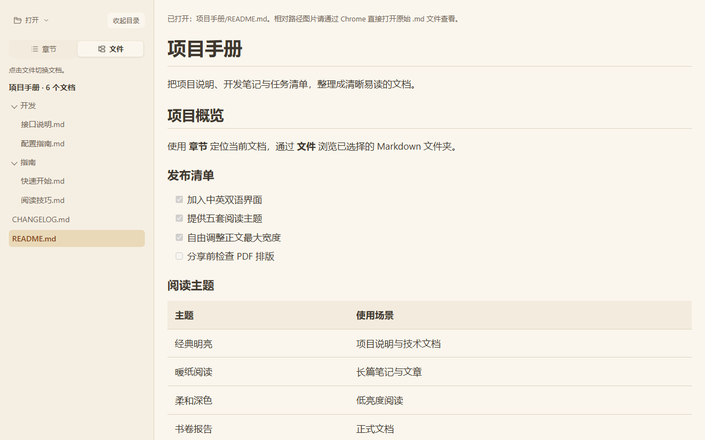
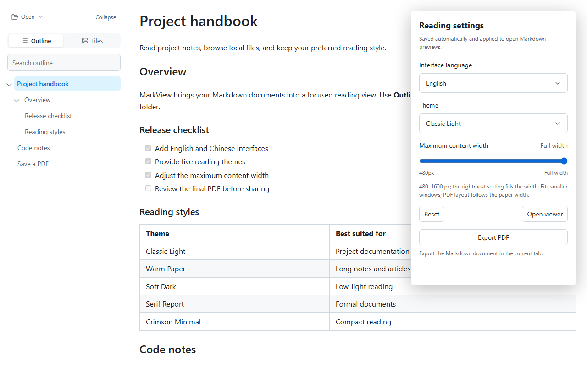

# 墨览 · MarkView

用于本地 Markdown 阅读的 Chrome Manifest V3 扩展，无需构建、无需外部依赖。

截至 2026-10-21，[Chrome 商店](https://chromewebstore.google.com/detail/ehpgkiagfgnbbmcfeemceglgfbojmcbk)已发布版本为 **1.2.0**；**1.3.0 已提交商店审核，当前正在审核中**。本仓库源码版本为 **1.3.0**。

## 功能

以下功能介绍以 1.3.0 源码为准，其中五套阅读主题、正文宽度设置、中英双语界面和 PDF 导出入口为 1.3.0 新增功能，待商店审核通过并发布后提供给商店用户。

- 直接预览本地 Markdown 文件，也可选择或拖入文件。
- 章节导航与搜索、只读文件夹浏览、阅读位置记忆。
- 五套阅读主题、正文宽度设置、简体中文和 English 界面。
- 代码高亮与复制，通过浏览器打印预览另存为 PDF。
- 文档内容在本地处理，不上传正文。

## 安装

### Chrome 商店安装

前往 [墨览 · MarkView 商店页面](https://chromewebstore.google.com/detail/ehpgkiagfgnbbmcfeemceglgfbojmcbk) 安装。当前商店提供 1.2.0，实际可安装版本以商店页面为准。

安装后如需直接预览本地文件，请在扩展「详情」中开启「允许访问文件网址」。

### 源码加载（1.3.0）

1. 下载仓库源码并解压，或克隆仓库。
2. 打开 `chrome://extensions`，开启「开发者模式」。
3. 点击「加载已解压的扩展程序」，选择仓库内的 `markdown-preview` 目录。
4. 如需直接预览本地文件，在扩展「详情」中开启「允许访问文件网址」。
5. 用 Chrome 打开 `.md` 文件，或点击扩展图标后选择「打开预览页」。

详细功能和使用边界见 [使用说明](markdown-preview/README.md)。

## 界面预览

截图对应 1.3.0，使用公开示例和演示接口展示界面；当前商店 1.2.0 的界面和功能与截图有所不同。

## 项目资料

- [源码与扩展目录](markdown-preview/)
- [打包与素材生成](store/markview/README.md)
- [隐私政策](store/markview/PRIVACY.md)
- [手动验收清单](store/markview/source/regression.md)

1.3.0 正在商店审核中。需要从源码加载或自行打包时，可按上述安装方法和打包说明操作。

## 开发记录

项目于 2026-09-20 开始开发。本仓库迁入了个人维护仓库中的早期源码提交，保留原始提交时间；迁移时统一了个人提交身份，并排除了旧安装包及商店过程资料。功能演进见 [更新记录](CHANGELOG.md)。

## 问题与建议

请通过 [GitHub Issues](https://github.com/yunxu-it/markview/issues) 提交问题或建议。反馈问题时请提供扩展版本、Chrome 版本、复现步骤和可公开的最小 Markdown 示例。

## 许可证

本项目原创代码与文档采用 [MIT License](LICENSE)，允许使用、修改、分发和商业使用；复制或分发时须保留版权及许可声明。

第三方内容继续遵循其原有许可，Bear 主题适配的来源与版权声明见 [第三方许可](markdown-preview/licenses/bear-theme-MIT.txt)。